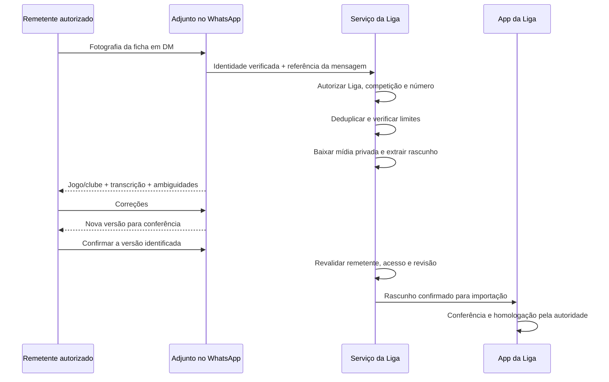

# Adjunto das Ligas · chat, WhatsApp e Matchday

27/10/2026. Atualização da central, ainda sem publicação. Nome do produto: **Adjunto** em PT-PT; **Auxiliar técnico** em PT-BR. Identificadores internos legados como `copilot` e `/api/league-copilot` foram preservados por compatibilidade.

## Entrega atual

| Área | Feito nesta versão | Falta para operação completa |
|---|---|---|
| Nome | Navegação, entrada, cartões e chat; verificação PT-BR | Revisar materiais antigos quando forem reeditados |
| Chat | Chat generativo conectado no código para gestores autenticados; demonstração local guiada; atalhos e histórico em memória | Ativar configuração/cota no ambiente de teste, validar chamada real e depois publicar; persistência multi-dispositivo |
| WhatsApp | Fluxo mapeado, editor de política proposta, regras puras testadas para autorização e confirmação | Transporte de mídia, vinculação/verificação, banco/filas, respostas reais, importação e implantação |
| Matchday | Opção por sessão, acesso ao motor real existente na conta; simulação funcional de início/golo/cartões/fim na demo | Preferência partilhada por Liga, ensaio real com operador e observador em duas contas |

Na demonstração, o chat recebe os dados já disponíveis na tela e responde por regras. Na versão autenticada, chama o endpoint existente com task chat; o servidor revalida gestor e competição, monta contexto mínimo e reserva a cota antes da Anthropic. Não homologa nem envia mensagens. Histórico existe apenas na memória da central/competição: navegar entre suas áreas mantém a conversa; recarregar ou sair limpa-a. A edição de política WhatsApp não concede acesso: é um plano exportável.

A revisão automática inicialmente rejeitou a integração externa. Em 27/10/2026, o utilizador autorizou explicitamente o envio à Anthropic de perguntas e resumo autorizado com nomes dos clubes, resultados e contagens de pendências, sem contatos ou licenças. A integração foi então implementada no código, sem deploy ou envio real nesta verificação. O contexto é construído no servidor: clubes presentes nos jogos, placares apenas homologados e contagens; campos extras do cliente/banco, contatos e licenças não são incorporados. O histórico recente também acompanha as perguntas. Padrões detectáveis de email, telefone internacional, sequências longas de números e identificadores de licença são recusados antes da inferência; a interface pede que esses dados não sejam incluídos. Isso não é um detector universal de dados pessoais em texto livre.

## WhatsApp: percurso proposto

### Política de acesso

Padrão: somente organizador com vínculo ativo de owner/manager na Liga. Alternativa: um ou dois números internacionais, distintos e explicitamente autorizados, vinculados a pessoas com papel ativo de operação. A autorização de um número não transforma um adepto em gestor. Se o operador tiver escopo de uma competição, ele não pode usar outra.

Somente DM. Grupos, broadcasts e autores de encaminhamentos não são fontes de autorização. Conferir número inteiro normalizado e identidade obtida do transporte; nunca sufixos, nome de exibição, legenda da foto ou alegação no texto. Os dois números são limite por política da Liga; não dois números por pessoa ou por pedido.

Vinculação proposta: gestor autenticado inicia na app → serviço cria código aleatório, curto em validade, de uso único → a pessoa envia o código ao bot a partir do número pretendido → transporte comprova o número → gestor confirma a vinculação. A política deve ser reconsultada em cada receção, confirmação e importação; revogar acesso invalida os próximos passos, incluindo rascunhos antigos. Nenhum código real foi criado nesta entrega.

### Conferência por quem enviou

O rascunho precisa identificar `leagueId`, `competitionId`, `matchId`, `teamId`, `senderPlayerId`, número vinculado, mensagem de origem, revisão, hash de conteúdo e validade. Confirmação deve citar esse rascunho e versão, preferencialmente por botão ou link autenticado. Um “sim” solto numa conversa não deve aprovar o último documento implicitamente.

Correções produzem nova versão e invalidam confirmação anterior. Só o remetente original pode confirmar neste desenho inicial. Troca de remetente ou revisão gera recusa. Eventual revisão substitutiva pela direção exige ação separada, motivo e auditoria; não foi implementada.

Confirmar gera **rascunho pronto para importação**, não resultado homologado. Importação deve usar transação/idempotência por mensagem+rascunho+revisão, conferir estado/seq do jogo, comparar eventos já existentes e não duplicar golos. Uma ficha de um clube não substitui a da outra equipa. Marcas e licenças ambíguas continuam para revisão.

### Integração com o que já existe

O repositório já contém `wa-bot/src/adjunto/`, com identificação de DM, router, orçamento, propostas e ligação de identidade. `wa-bot/src/index.js` encaminha DMs ao Adjunto. O router atual extrai texto/legendas; isso não comprova download, OCR ou importação de ficha da Liga. Os dados de grupos/jogos semanais e os de ligas têm autorizações distintas.

Ponto recomendado: adaptador de receção de ficha de Liga após identificação segura da DM, antes de tratar o conteúdo como conversa de um grupo recorrente. Reutilizar transporte e envio; manter autorização, orçamento e estado de rascunho próprios. Não reutilizar comportamento de planos que permite prosseguir quando falta configuração: para ligas, falhar fechado.

O piloto pode reutilizar o transporte Baileys existente. A documentação do projeto descreve [download de mídia recebida](https://github.com/WhiskeySockets/Baileys/blob/master/README.md?plain=1). Para uma operação gerida pela API oficial, avaliar o [fluxo de webhooks da coleção oficial Meta](https://www.postman.com/meta/whatsapp-business-platform/folder/lboq68h/webhooks) e os [recursos de desenvolvimento WhatsApp](https://whatsappbusiness.com/developers/developer-hub/). Não instalar o antigo SDK Node arquivado. A escolha de transporte, custos, regras de mensagens e credenciais ainda precisa ser fechada antes da implantação.

### Dados e serviços a implementar

- Registro de operadores da Liga com número verificado, pessoa, papel/escopo, status, datas e quem autorizou; acesso administrativo apenas.
- Rascunhos versionados e privados, com documento no Storage privado, chave/hash de origem, remetente, estado e auditoria; sem URL pública.
- Fila de processamento com deduplicação por identificador original, retries limitados, cota e limites de arquivo/páginas.
- Início com fotografia JPG/PNG/WebP compatível com o leitor existente. PDF requer etapa específica de validação/renderização, não apenas aceitar a extensão.
- Política de retenção e eliminação de documentos/mídia, trilha de acesso e logs sem imagem, número completo ou licença.
- Limites de sessão de mensagens e templates conforme o transporte escolhido; não prometer lembretes proativos ilimitados.
- Rota de confirmação autenticada no app quando a extração tiver tabelas longas ou ambiguidades. Não enviar toda a base ou plantéis de outras ligas ao bot.

Os contratos `validateWaLeaguePolicy`, `canUseLeagueAdjunto` e `confirmLeagueWaDraft` estão em `src/lib/leagueAdjunto.js` e têm testes. São lógica preparada para a integração, não um endpoint público, tabela aplicada ou bot ativado.

## Matchday opcional

A central oferece **Ficha após o jogo** ou **Matchday ao vivo** nesta sessão. Na conta conectada, abrir o jogo leva à implementação existente (`LeagueCloudMatchPage` / `LeagueCloudLiveControls`). Ela utiliza funções com verificação de papel, `seq` e idempotência; não foi criado um segundo motor para resultados oficiais.

O fluxo existente inclui início/fim, golos e assistência quando indicada, cartões, plantéis/formações, correções/histórico, MVP e homologação conforme permissões e regulamento. Esta atualização não afirma que todas essas operações foram testadas novamente em produção. A demonstração acrescentada é menor: início, golo/amarelo/vermelho, timeline, relógio de referência e término provisório.

O relógio não inventa o minuto do lance. O resultado ao vivo não entra automaticamente na tabela oficial. A Liga pode continuar a trabalhar por papel; não precisa ativar o Matchday para receber fichas ou publicar resultados.

Uma preferência persistente por Liga ainda deve ser implementada no backend, se desejada. Escolher o modo nesta prévia não altera autorizações ou configuração partilhada. No piloto AFPCE, direção opera; delegar mesa/árbitro ou permitir clubes exige regra e papéis explícitos.

## Verificações

56 testes selecionados passaram na verificação final, incluindo sete casos de integração generativa. Dez testes de Adjunto/WhatsApp/Matchday cobrem nomes PT-PT/PT-BR, chat guiado, política com no máximo dois números, DM verificada, vínculo/escopo/revogação, confirmação pelo mesmo remetente e revisão exata, idempotência do lance e estado provisório.

17 checagens novas de navegador passaram: chat/contexto, histórico, exportação sem ativação, Matchday completo na demo, tabela oficial preservada, 320/390 px, nome PT-BR e ausência de pedidos de API pelo chat. A regressão da central passou em 24 checagens. Não houve envio de WhatsApp ou dados do chat a um fornecedor.
